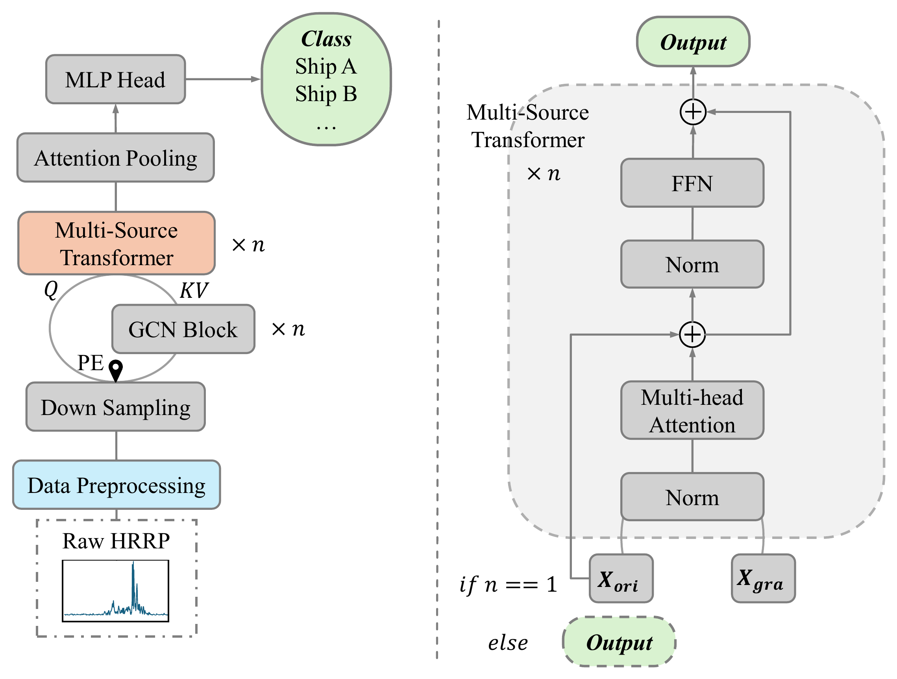

# S2D FusionNet: Sequence-to-Two-Dimensional Feature Fusion Network for Radar HRRP Target Recognition

Official PyTorch implementation of the **S2D FusionNet** architecture for High-Resolution Range Profile (HRRP) radar target recognition.

[](https://pytorch.org/)
[](https://www.python.org/)
[](LICENSE)

---

## Architecture Overview

<p align="center">
  
</p>

**S2D FusionNet** is designed to jointly model local scattering responses and non-Euclidean topological relationships among scattering centers from radar HRRP sequences.

```
       1D HRRP Sequence [B, 1, L]
                  │
                  ▼
      Dimension Converter (S2D) ───► Relative Position Matrix (RPM) / GASF / GADF
                  │
                  ▼
         2D CNN Downsampling
                  │
       ┌──────────┴──────────┐
       ▼                     ▼
  Local Tokens          Dynamic KNN GCN
    (Query)             (Key & Value)
       │                     │
       └──────────┬──────────┘
                  ▼
   Multi-Source Cross-Attention (MSCA)
   with Rotary Position Embedding (RoPE)
                  │
                  ▼
        Attention-based Pooling
                  │
                  ▼
         Classification Head
                  │
                  ▼
        Target Class Logits
```

### Key Components

1. **Dimension Converter (S2D Mapping)**:
   Converts 1D HRRP temporal/spatial sequences into structured 2D matrices using Relative Position Matrix (**RPM**), Gramian Angular Summation Field (**GASF**), Gramian Angular Difference Field (**GADF**), or a **Hybrid** 3-channel combination. A lightweight 2D convolutional downsampling module subsequently extracts local scattering tokens.

2. **Dynamic KNN Graph Convolution (GCN)**:
   Dynamically constructs a $K$-nearest neighbor graph in the feature space, capturing non-local topological correlations between distributed scattering centers via EdgeConv.

3. **Multi-Source Cross-Attention (MSCA)**:
   Asymmetrically aligns local scattering evidence (Query) with graph-enhanced topological context (Key and Value), equipped with Rotary Position Embedding (**RoPE**) to preserve relative spatial order.

4. **Attention-Weighted Global Pooling**:
   Aggregates token-level representations into a compact global signature for robust target classification.

---

## Directory Structure

```text
s2dfusionnet/
├── assets/
│   └── framework.png          # Architecture diagram
├── __init__.py                # Package exports and versioning
├── framework.py               # S2DFusionNet top-level model definition
├── dim_converter.py           # S2D conversion and 2D CNN downsampling
├── gcn.py                     # Dynamic KNN Graph Convolution (EdgeConv)
├── multisource_transformer.py # Multi-Source Cross-Attention (MSCA) and Transformer block
├── position_encoding.py       # RoPE, Sinusoidal, and Trainable positional encodings
├── utils.py                   # Tensor mathematical transformations (RPM, GASF, GADF, Hybrid)
├── demo.py                    # Verification and demonstration script
├── requirements.txt           # Minimal dependencies
├── LICENSE                    # MIT License
└── README.md                  # Project documentation
```

---

## Installation

### Prerequisites

- Python $\ge$ 3.8
- PyTorch $\ge$ 1.12.0
- NumPy $\ge$ 1.20.0

```bash
git clone https://github.com/<your-username>/s2dfusionnet.git
cd s2dfusionnet
pip install -r requirements.txt
```

---

## Quickstart

Run the built-in verification demo:

```bash
python demo.py
```

### Python API Usage

```python
import torch
from framework import S2DFusionNet

# 1. Instantiate model with standard configuration
model = S2DFusionNet(
    method="RPM",       # S2D representation: 'RPM', 'GASF', 'GADF', or 'Hybrid'
    k=12,               # Number of dynamic KNN neighbors
    heads=4,            # Number of attention heads
    num_classes=10,     # Number of target classes
    dim=128,            # Feature dimension
    gcn_layers=1,       # Number of GCN layers
    tf_layers=1,        # Number of Transformer layers
    petype="rope",      # Positional prior: 'rope', 'tra', 'sin', or 'none'
    dropout=0.1,
)

# 2. Prepare input tensor (Batch_size, Channels=1, Sequence_length=64)
dummy_hrrp = torch.randn(8, 1, 64)

# 3. Forward pass
# Standard inference:
logits = model(dummy_hrrp)
print("Classification logits:", logits.shape)  # torch.Size([8, 10])

# Feature extraction (for t-SNE / representation analysis):
logits, features = model(dummy_hrrp, return_feature=True)
print("Global features:", features.shape)       # torch.Size([8, 128])
```

---

## Hyperparameter Guide

| Parameter | Type | Default | Description |
| :--- | :---: | :---: | :--- |
| `method` | `str` | `'RPM'` | S2D mapping strategy: `'RPM'`, `'GASF'`, `'GADF'`, or `'Hybrid'`. |
| `k` | `int` | `12` | Neighborhood size $K$ for dynamic KNN graph construction. |
| `heads` | `int` | `4` | Number of attention heads in multi-source cross-attention. |
| `num_classes` | `int` | `10` | Number of target output classes. |
| `dim` | `int` | `128` | Latent channel dimensionality across GCN and Transformer. |
| `gcn_layers` | `int` | `1` | Number of stacked dynamic graph convolution layers. |
| `tf_layers` | `int` | `1` | Number of stacked multi-source Transformer blocks. |
| `petype` | `str` | `'rope'` | Positional encoding: `'rope'` (Rotary), `'tra'` (Trainable), `'sin'` (Sinusoidal). |
| `dropout` | `float` | `0.1` | Dropout probability in attention and feed-forward networks. |

---

## Citation

If you find this work or model code useful in your research, please cite our paper:

```bibtex
@article{s2dfusionnet2026,
  title   = {Sequence-to-Two-Dimensional Feature Fusion Network for Measured Ship High-Resolution Range Profile Target Recognition},
  author  = {Gao, J. and et al.},
  journal = {Sensors},
  year    = {2026}
}
```

---

## License

This project is licensed under the [MIT License](LICENSE).
